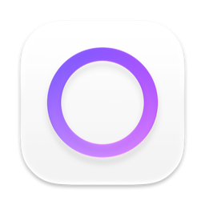
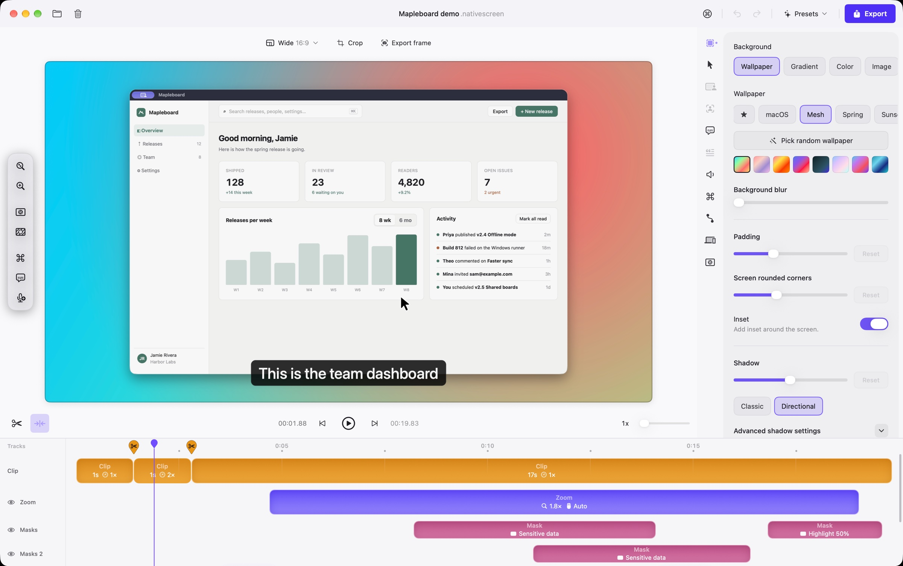
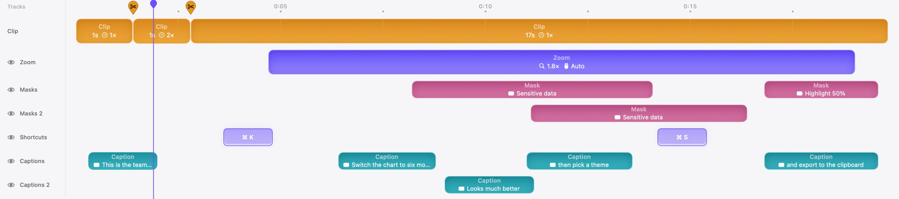

<div align="center">



# Native Screen

**Polished screen recordings and product demos, made on your computer.**
Free and open source. Native on macOS and Windows.

[Website](https://maitrungduc1410.github.io/NativeScreen/) ·
[Download for Mac](https://github.com/maitrungduc1410/NativeScreen/releases/latest/download/NativeScreen.dmg) ·
[Download for Windows](https://github.com/maitrungduc1410/NativeScreen/releases/latest/download/NativeScreen-win-Setup.exe) ·
[All releases](https://github.com/maitrungduc1410/NativeScreen/releases)

</div>



See it move on the [website](https://maitrungduc1410.github.io/NativeScreen/).

## Why Native Screen

- **A real multi-track timeline.** Zooms, blur and spotlight masks, captions and keyboard shortcuts each get their own
  tracks, as many as you need. Overlap two blurs, stack caption lines, drag items between tracks, snap everything to
  edges and the playhead.
- **Automatic polish.** Zooms follow your clicks and typing, the cursor glides instead of shaking, and motion blur
  makes fast moves look filmed.
- **Everything stays on your machine.** Recording, captions, transcript editing, sensitive data detection and export
  all run locally. No account, no upload, no watermark.
- **Native, not a web wrapper.** SwiftUI, AppKit and Metal on macOS, WinUI 3 and Direct3D 11 on Windows, with the
  system's own windows, menus and shortcuts. Hardware encoding, no FFmpeg, and no CPU use while the editor sits
  still.
- **Let an AI agent do the editing.** Claude, Codex, Cursor and other MCP clients can record, edit, restyle and export
  through the app. Every change lands in the editor you see and can be undone.
- **Light and dark**, and **eight languages**: English, Tiếng Việt, 简体中文, 日本語, Deutsch, Français, Español and
  Português (Brasil).



## Features

**Record**
- Whole display, one window or a selected area, at native resolution and up to 60 fps.
- Camera, microphone and system audio as separate tracks. Pause and resume.
- Crash safe: the recording is written in small pieces, so a lost take can be recovered.

**Edit**
- Cut, trim, speed up and merge clips. Typing bursts are found for you and can be sped up in one click.
- Zoom track with automatic and manual zooms, or a loupe that magnifies one spot.
- Blur and spotlight masks on as many tracks as you need, plus automatic detection of emails, keys and faces.
- Keyboard shortcuts shown as 3D keycaps on their own tracks.
- Wallpapers, gradients, padding, shadows, device frames, crop, and aspect ratios for every platform with safe zones
  for Reels, TikTok and Shorts.
- Camera layouts, styles and background removal.
- Undo everything. Presets to reuse a look across projects.

**Captions and transcript**
- On-device captions with line or word animation and per-caption styles.
- Edit by transcript: remove filler words and tighten pauses in one pass, or cut a sentence by deleting its words.
- Export captions as `.srt`.

**Export**
- MP4, ProRes and GIF, 720p to 4K, hardware accelerated.
- Quick export to a file or straight to the clipboard, still frames as PNG or JPEG.

## Install

| | Requirement | Download |
| :-- | :-- | :-- |
| macOS | macOS 15 or later, Apple silicon or Intel | [NativeScreen.dmg](https://github.com/maitrungduc1410/NativeScreen/releases/latest/download/NativeScreen.dmg) |
| Windows | Windows 10 or 11, x64 | [NativeScreen-win-Setup.exe](https://github.com/maitrungduc1410/NativeScreen/releases/latest/download/NativeScreen-win-Setup.exe) |

**macOS.** Open the DMG and drag Native Screen to Applications. The app is signed and notarized by Apple. On first
launch macOS asks for Screen Recording permission, and for camera and microphone when you turn them on. Updates arrive
inside the app (`Native Screen > Check for Updates...`).

**Windows.** The Windows build is not code signed yet (we have applied for free signing for open source projects).
Until then Windows SmartScreen shows a blue "Windows protected your PC" screen the first time. Click **More info**, then
**Run anyway**. You can check the download against the SHA-256 shown on the release page. Updates install themselves
after that.

## Let an AI agent drive it

Turn on `Settings > AI Agents` in Native Screen. The page shows the exact command for your machine, for example:

```bash
claude mcp add nativescreen -- "/Applications/Native Screen.app/Contents/MacOS/Native Screen" --mcp
```

Then ask things like *"record my browser window for 20 seconds, zoom in on every click, add captions and export a
1080p MP4"*. The agent talks to the running app over a local socket that only your user account can open.

> **🎬 Demo placeholder (AI agent, ~15 s, sped up):** a terminal with an agent on the left, Native Screen on the right.
> The agent's tool calls scroll by while zooms and captions appear on the timeline and an export finishes.

## Build from source

**macOS:** Xcode 27 or later.

```bash
open NativeScreen/NativeScreen.xcodeproj
```

Run the `NativeScreen` scheme. Local builds have no updater, so they never replace themselves with a release.

**Windows:** .NET 10 SDK and the Windows App SDK workload, on Windows 10 or 11.

```bash
dotnet run --project windows/src/NativeScreen.App -c Debug -p:Platform=x64
```

`pwsh windows/scripts/verify.ps1` builds everything and runs the tests.

## Repository

| Path | What is there |
| :-- | :-- |
| [`NativeScreen/`](NativeScreen/) | macOS app (SwiftUI, Metal, ScreenCaptureKit) |
| [`windows/`](windows/) | Windows app (WinUI 3, Direct3D 11, Media Foundation) |
| [`spec/`](spec/README.md) | File format, rendering math, engineering decisions and the feature checklist |
| [`conformance/`](conformance/) | Reference projects and frames both apps must match |
| [`site/`](site/) | The website |
| [`docs/releasing.md`](docs/releasing.md) | How releases are built, signed and published |

Projects are folders (`.nativescreen`) with a documented JSON format ([`spec/02`](spec/02-FILE-FORMAT-AND-SCHEMA.md)),
so the same project opens on both platforms.

## Contributing

Issues and pull requests are welcome. Read [`AGENTS.md`](AGENTS.md) and the relevant part of [`spec/`](spec/README.md)
first: behavior is specified there before it is written.

## License

[MIT](LICENSE) © Duc Trung Mai
